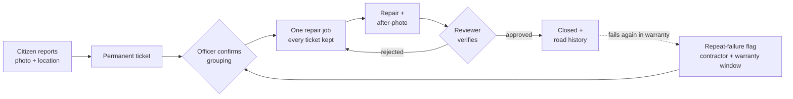

> Source version: this repository now includes the Next.js RoadWatch application and its complete source history through commit `6d2565e`, alongside the repository's original history and license. This is the earlier public demo with a browser-local `/try` lifecycle. The newer integrated countdown demo at https://roadwatch-repair-countdown.just-cream-1659.chatgpt.site/ was inspected, but its source files were not available for this upload. See [source setup and verification notes](docs/SOURCE-README.md) and [button audit](docs/BUTTON-AUDIT.md).
<div align="center">


# RoadWatch

### The road remembers.

**A pothole complaint ends. Accountability doesn't.**<br/>
One repair job per defect · every citizen keeps their ticket · a road history that catches the next failure.

<br/>

<a href="https://roadwatch-hema-protohack.hemabhushantadithuri.chatgpt.site/"></a>
<a href="https://roadwatch-hema-protohack.hemabhushantadithuri.chatgpt.site/try"></a>
<a href="https://roadwatch-hema-protohack.hemabhushantadithuri.chatgpt.site/presentation"></a>

<a href="https://roadwatch-hema-protohack.hemabhushantadithuri.chatgpt.site/evidence"></a>
<a href="https://roadwatch-hema-protohack.hemabhushantadithuri.chatgpt.site/roads"></a>
<a href="#-quick-start"></a>

<br/><br/>


</div>

---

## 🛣️ The problem

Pothole apps are good at collecting complaints. They are weaker at what happens next:

- Complaints get marked "resolved" with no visible repair.
- Duplicate reports get rejected instead of merged, so people file the same pothole again.
- A repaired road fails again, and nobody can see who fixed it or whether it was still under warranty.

RoadWatch is built around the part that comes **after** the complaint.

## ✨ What RoadWatch does

| | Feature | In one line |
|---|---|---|
| 🎫 | **Permanent tickets** | Every citizen keeps their own ticket, even when reports are merged. |
| 🤝 | **Officer-confirmed grouping** | Nearby reports become **one repair job**. A human confirms; nothing auto-merges. |
| 🧾 | **Verified closure** | A job cannot close without an after-photo and a reviewer's sign-off. |
| 🧠 | **Repair memory** | Every road segment keeps its repair history. |
| 🚨 | **Repeat-failure flag** | A new failure after a repair shows the contractor and warranty window. |
| ⏱️ | **Repair Countdown** | Every complaint has a live fix-by timer that turns red when overdue. |
| 📊 | **Transparent priority** | A visible formula ranks repairs. Report count never changes priority. |
| 🤖 | **Optional AI copilot** | AI can only *suggest*. Every suggestion needs a human decision and is logged. |

> **The seeded demo moment:** *"Failed within 35 days of Metro Roads Ltd.'s repair, warranty window 90 days."*

## 🔄 How it works



## 🧮 The rules (all deterministic and explainable)

| Rule | How it works |
|---|---|
| **Grouping** | Suggested only for the same road segment, within **20 m** and **7 days**. An officer always confirms. |
| **Priority** | `50 × severity + 30 × sensitive location + 20 × min(days waiting / 7, 1)`. Every component is shown next to the score. Worked examples: **86** and **33**. |
| **Repeat queue** | At least two accepted incidents in 90 days, plus a new incident after a recorded repair on the same segment. |
| **Warranty attribution** | Elapsed time is computed from actual dates against the repair's warranty window. |
| **Repair Countdown** | Before assignment: a 7-day planning target. After assignment: the officer's due date, valid through the whole UTC day. Turns red the next midnight, freezes when repair evidence is recorded. |
| **Risk score** | A visible **heuristic v1** with six contributions. It is not trained ML, and it never changes priority or status. |

## 🤖 AI governance: rules lead, AI assists

AI is optional, and every deterministic flow works without an API key.

- AI outputs are **suggestions** (photo triage, duplicate candidates, incident brief, voice-to-draft).
- Every suggestion is logged in `ai_suggestions` with model, version, confidence, input snapshot and the human's decision.
- AI never changes a status, closes a ticket, or bypasses RLS.
- Seed AI badges are labelled **demo fixtures**, never presented as live inference.

## 🔍 What's real and what's simulated

We label this everywhere in the app too.

| ✅ Real | 🧪 Simulated |
|---|---|
| 6 public pothole photos + 29 annotations ([Kaggle, CC0](https://www.kaggle.com/datasets/yamqwe/potholes-object-detection)) | Ticket locations, dates, severity, contractors, repair outcomes |
| 80 OpenStreetMap road segments in central Chennai (© OpenStreetMap contributors, ODbL) | Repair "after" images (labelled **DEMO ILLUSTRATION**) |
| The rule logic in `lib/` and its tests | Role switching in the browser demo (`/try`) is a simulation, not real auth |

**Verification status, stated plainly:**

- ✅ Typecheck, production build and the offline test suite pass (`npm test`).
- ✅ The complete practice flow works in the browser: report → assign → after-evidence → reviewer closure, saved locally.
- ⚠️ **Live Supabase, row-level security, real sign-in and private uploads are not yet verified end to end.** The 10 database integration tests exist but are skipped without credentials.
- ⚠️ No detection model was trained or evaluated.

## 🧭 Related work

RoadWatch is not the first pothole tool, and it doesn't claim to be. Related efforts include
[iWatchRoadv2](https://arxiv.org/abs/2510.16375) (dashcam detection mapped to road segments and contractors) and
[Pothole Reporter](https://github.com/coding-parrot/pothole-reporter) (matches detected potholes to road contracts).
Those start from AI detection. **RoadWatch starts from the citizen complaint and the human workflow around it:** officer-confirmed merges, reviewer-gated closure, and visible rules, with no special hardware.

## 🚀 Quick start

```sh
git clone https://github.com/keerthana911-netizen/PROTOHACK.git
cd PROTOHACK
npm ci
npm run dev
```

Open <http://localhost:3000>. Without Supabase environment values the app runs as a **read-only demo** with a working browser-local practice at `/try`. Requires Node.js 20.19+.

```sh
npm test            # offline test suite
npm run typecheck
npm run build
```

<details>
<summary><b>🗄️ Run with a real database (local Supabase)</b></summary>

1. Start Docker Desktop, then `npx supabase start` (migrations and `supabase/seed.sql` run automatically).
2. Copy `.env.example` to `.env.local` and set `NEXT_PUBLIC_SUPABASE_URL` and `NEXT_PUBLIC_SUPABASE_ANON_KEY` from `npx supabase status`. Leave `OPENAI_API_KEY` empty to test the fully deterministic workflow.
3. Upload the private demo photos: `node --env-file=.env.local scripts/upload-demo-photos.mjs` (needs `SUPABASE_SERVICE_ROLE_KEY` in the ignored `.env.local`).
4. Restart Next.js and sign in with a demo account.

| Role | Email | Password |
|---|---|---|
| Citizen | `citizen@roadwatch.demo` | `RoadWatchDemo!2026` |
| Ward Officer | `officer@roadwatch.demo` | `RoadWatchDemo!2026` |
| Reviewer | `reviewer@roadwatch.demo` | `RoadWatchDemo!2026` |

These are **demo credentials for a disposable local project**. Rotate or remove them before any real deployment. To reset local data: `npx supabase db reset`.

For a cloud project, apply the eight files in `supabase/migrations/` in order, run `supabase/seed.sql`, and set the same environment variables on your host.

</details>

<details>
<summary><b>🏗️ Architecture and security</b></summary>

- **Next.js App Router + TypeScript**, mobile-first PWA, Tailwind.
- **All writes are Server Actions**, with no REST write routes. Each action validates input and derives the user's role from the server session.
- **Postgres + PostGIS + RLS:** citizens see only their own records, officers their own ward, reviewers across wards.
- **Database triggers** write one append-only `status_events` row per status change, and block closure without an after-photo and reviewer verification.
- **Private photo bucket** with signed URLs that expire in 120 seconds, plus server-side file-type checks.
- **Pure logic, fully unit-tested:** `lib/priority.ts`, `lib/merge.ts`, `lib/repeat.ts`, `lib/risk.ts`, plus the countdown logic.
- **AI is isolated** in `lib/ai.ts` (server-only, Zod-validated outputs, timeout, retry, cache).

</details>

<details>
<summary><b>📁 Project structure</b></summary>

```text
app/            pages: dashboard, tickets, incidents, /try, /report, /roads, /evidence, /presentation
components/     UI: dashboard, practice workspace, maps, countdown, exports
lib/            rules and server actions: priority, merge, repeat, risk, ai, actions
supabase/       migrations, seed.sql, config
tests/          unit tests, security contract tests, live DB integration tests
data/           OSM road extract, pothole sample labels and provenance
scripts/        data fetch/export utilities, demo photo upload
docs/           handoff, button audit, UI and reliability review
```

</details>

<details>
<summary><b>🧪 Known limits and what's next</b></summary>

**Scope choices:** one ward (Ward 12, Chennai), ten manually labelled segments, officer and reviewer accounts provisioned by an administrator, notifications as in-app follow-up notes rather than email or push.

**Build later:** multilingual support, municipal integrations, a WhatsApp bot, a trained and calibrated risk model (needs far more labelled data), a fine-tuned pothole classifier, road-segment correction, realtime notifications, pagination and rate limits, production observability.

</details>

## 🙌 Team

**Team CUDA Crew**, SRM Institute of Science and Technology, Ramapuram, built for the Synergy *Prototype* hackathon (finals).

| Name | Role |
|---|---|
| Keerthana Lahari T | Team lead · _add your contribution_ |
| Sanjay Krishna OB | _add your contribution_ |
| V Priyadharshini | _add your contribution_ |

## 📜 Credits and licences

- Pothole photos and annotations: [Yam Peleg's Potholes Object Detection dataset](https://www.kaggle.com/datasets/yamqwe/potholes-object-detection), credited to [Make ML](https://makeml.app/datasets/potholes) (CC0).
- Road geometry: © [OpenStreetMap contributors](https://www.openstreetmap.org/copyright), ODbL 1.0.
- Maps: Leaflet with OpenStreetMap tiles.

<div align="center">
<sub>Built for accountable roads · Deterministic rules · Human decisions · Lasting memory</sub>
</div>

